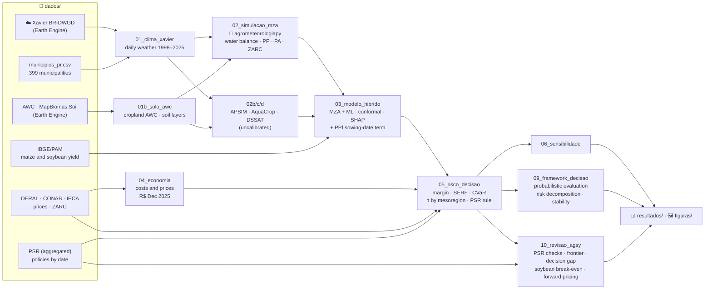

# 🌽 Second-Season Maize in Paraná — Sowing Date as a Risk-Management Decision


[](https://github.com/fcoliveira-utfpr/agrometeorologiapy)
[](https://pypi.org/project/agrometeorologiapy/)

-0e75b6)

-orange)

Research code, data and analyses for the article *Sowing date as a risk-management decision in soybean–maize
double cropping: a physics-guided, insurance-validated agro-economic framework* (to be submitted to
**Agricultural Systems**, Elsevier).

The study ranks the sowing dates of **second-season (safrinha) maize after soybean in the 399 municipalities of
Paraná, Brazil**, by their **risk-adjusted return**. A simple crop model, the **FAO Agro-Ecological Zone model
(MZA-FAO)**, simulates water, frost and heat stress by phenological phase for nine sowing dates; a **hybrid
machine-learning model** turns these indicators into calibrated yield distributions, with the **sowing-date
response of potential yield taken from the crop model**; and an **economic layer** combines yield, price, cost and
crop insurance (PSR) under the official climate risk zoning (ZARC) to rank the dates by the certainty equivalent of
the margin. The recommendation is checked against **124 thousand crop insurance policies** and confronted with the
soybean trade-off, forward pricing and the current sowing calendar.

MZA-FAO runs on the **[agrometeorologiapy](https://pypi.org/project/agrometeorologiapy/)** library
(`pip install agrometeorologiapy`), by the same author.

UTFPR – Santa Helena Campus · Prof. Dr. Fabrício Correia de Oliveira

---

## 🔎 Main results

- **Calibrated yield distributions** — ensemble of a monotonic gradient boosting and a support vector regression on
  MZA-FAO features. Leave-one-year-out validation (23 folds, 2003–2025, 6,806 municipality-years): R² = 0.43
  (municipality), 0.54 (microregion), 0.61 (mesoregion), 0.67 (state, between years); flat PIT and 80% coverage of
  the 80% conformal interval. Uncalibrated APSIM, DSSAT and AquaCrop do not beat the simple model.
- **Yield statistics cannot identify the sowing-date response** — IBGE municipal yields mix sowing dates and do not
  record them, so the ML learns the response to the weather of a season, not to the date. Without a physical term,
  the hybrid recommended mid-March in 27 western/northwestern municipalities; insurance claims contradicted it.
  Adding log PPf(date) − mean log PPf of the training window (β = 1, from the crop model) made the model reproduce the
  yield response to the observed sowing calendar (−2.0% per 10 days in model and data; −1.1% without the term).
- **Insurance evidence** — PSR policies (start of coverage ≈ sowing): indemnified share rises from 19% (≤ 20 Jan) to
  42–47% (≥ 1 Mar), +11 p.p. with season fixed effects. The model still underestimates March losses (declared limit).
- **Decision** — 5 January maximizes the certainty equivalent (relative risk aversion 2) in 359 of 372
  municipalities and is the efficient date on the mean-margin × CVaR frontier; stable in a median of 94% of season
  bootstrap resamples and in 90–99% of the sensitivity scenarios.
- **System and market** — relative to the sowing calendar observed in the insurance records (2022–2025), the
  recommended date adds R$ 278 ha⁻¹ in certainty equivalent (~R$ 710 million/yr), with better tail outcomes; this pays
  for up to 230–290 kg ha⁻¹ (7–9%) of soybean lost to an earlier soybean cycle. Yield explains 79% of margin risk and
  price 21%; the yield–price correlation (r = −0.74, detrended) makes forward sales worthwhile only as partial hedges.
- **Insurance and zoning** — field deviation τ calibrated by mesoregion on the PSR (0.26 Oeste … 0.58 Noroeste);
  the sowing-date-independent insured yield makes insurance worth more for late sowing; signs of adverse selection.

## 🗺️ How the files connect



## 📁 Structure

```text
.
├── 📓 notebooks/                      article pipeline (run in order)
│   ├── 01_clima_xavier.ipynb          daily weather at the municipal seats (BR-DWGD v3.2.4)
│   ├── 01b_solo_awc.ipynb             AWC over the cropland of each municipality; soil layers (MapBiomas Soil)
│   ├── 02_simulacao_mza.ipynb         MZA-FAO + ZARC criteria: 399 municipalities × 27 years × 9 dates
│   ├── 02b/c/d_simulacao_*.ipynb      APSIM NG, AquaCrop-OSPy, DSSAT CERES-Maize, uncalibrated
│   ├── 03_modelo_hibrido.ipynb        hybrid ML, generator comparison, conformal intervals, phase analyses, SHAP,
│   │                                  prediction per date with the potential-yield (PPf) sowing-date term
│   ├── 03b_comparacao_algoritmos.ipynb  ML algorithms (default, shallow, nested tuning)
│   ├── 04_economia.ipynb              costs (DERAL + CONAB Factor Income) and real monthly prices
│   ├── 05_risco_decisao.ipynb         margin, SERF, P(loss), CVaR, insurance/ZARC (PSR rule), τ by mesoregion, best date
│   ├── 06_sensibilidade.ipynb         sensitivity scenarios (thermal time, window, rooting depth) vs. baseline
│   ├── 07_material_suplementar.ipynb  earlier supplementary builder (kept for provenance)
│   ├── 08_estrutura_erros_calor_observado.ipynb  error structure and observed-yield/flowering-heat analysis
│   ├── 09_framework_decisao.ipynb     probabilistic evaluation, risk decomposition, natural hedge, stability, framework figures
│   ├── 10_revisao_agsy.ipynb          revision analyses: PSR sowing-date profile, IBGE calendar check, covariate shift,
│   │                                  forward pricing, soybean break-even, efficient frontier, decision gap,
│   │                                  stress-stratified validation, lower tail, SHAP by mesoregion
│   ├── revisao_agsy/                  exploratory scripts behind the revision decisions (README inside),
│   │                                  resumable weather download, MZA runner for Windows, supplementary and
│   │                                  Overleaf package builders
│   ├── modelo_mza.py                  one MZA-FAO cycle: degree-day phenology, Kc, ky, roots, ZARC, extreme indices
│   ├── modelo_apsim.py · modelo_aquacrop.py · modelo_dssat.py   process-model drivers
│   ├── rodar_lote.py                  parallel runs with a checkpoint per municipality
│   ├── sensibilidade.py               scenario definitions (environment variable SENS)
│   └── mapas.py                       choropleth maps without geopandas
├── 📂 dados/                          inputs (sources below)
├── 📊 resultados/                     outputs (CSV/parquet); sensibilidade/<scenario>/; revisao/; framework/
├── 🖼️ figuras/                        article figures (300 dpi)
└── 🧠 memoria_projeto.md              decisions, fixed bugs and next steps (in Portuguese)
```

## 📓 Notebooks

| # | Notebook | Input | Output |
|---|---|---|---|
| 1 | `01_clima_xavier` | Earth Engine, `municipios_pr.csv` | `dados/xavier_diario_pr.csv.gz` (not in git, 72 MB) |
| 1b | `01b_solo_awc` | Earth Engine (AWC, MapBiomas), municipal mesh | `municipios_pr.csv` (DTA), `solo_camadas_pr.csv` |
| 2 | `02_simulacao_mza` | daily weather, municipalities | `resultados/simulacao_mza_pr.parquet` |
| 2b–d | `02b/c/d_simulacao_*` | daily weather, soil layers | `resultados/simulacao_{apsim,aquacrop,dssat}_pr.parquet` |
| 3 | `03_modelo_hibrido` | simulations, `ibge_pam_milho_pr.csv` | validation tables, out-of-sample predictions, yield quantiles per municipality × year × date |
| 3b | `03b_comparacao_algoritmos` | `resultados/base_treino_hibrido.parquet` | `resultados/comparacao_algoritmos.csv` |
| 4 | `04_economia` | DERAL, CONAB, Ipeadata, IPCA | real costs and prices |
| 5 | `05_risco_decisao` | notebooks 3 and 4, ZARC, PSR aggregates | economic risk and best date per municipality, `tau_mesorregiao.csv` |
| 6 | `06_sensibilidade` | `resultados/sensibilidade/*` | `resultados/sensibilidade_cenarios.csv`, `fig_sensibilidade_ce.png` |
| 8 | `08_estrutura_erros_calor_observado` | out-of-fold predictions, observed yields | error summaries, Moran's I, heat fixed effects |
| 9 | `09_framework_decisao` | notebooks 3 and 5 | `resultados/framework/`, framework figures |
| 10 | `10_revisao_agsy` | notebooks 3, 5 and PSR aggregates | `resultados/revisao/`, `fig_resposta_data_psr.png`, `fig_sistema_decisao.png` |

## 📂 Data

| File | Source |
|---|---|
| `ibge_pam_milho_pr.csv` | IBGE/PAM, SIDRA table 839 — first- and second-season maize per municipality, 2003–2025 |
| `ibge_pam_soja_pr.csv` | IBGE/PAM, SIDRA table 1612 — soybean planted area and yield per municipality, 2000–2025 |
| `municipios_pr.csv` | Seat coordinates, altitude, soil available water (DTA, ANA map over cropland), particle size, mesoregion |
| `malha_municipios_pr.geojson` | IBGE municipal boundaries |
| `solo_camadas_pr.csv` | MapBiomas Soil Collection 3 — clay and sand in 10 layers (0–100 cm) |
| `nhistorico_94.xls` | SEAB/DERAL — second-season maize production cost, seasons 1999/00–2024/25 |
| `milho_2a_safra_serie_historica_2005-2025.xls` | CONAB — second-season maize cost (Factor Income share) |
| `custos.xlsx` | SEAB/DERAL — itemized cost (2025–2026) |
| `ipea_precos_milho_mensal.csv` · `ipea_precos_soja_mensal.csv` | Maize and soybean prices received by farmers in Paraná (SEAB/DERAL via Ipeadata) |
| `ipca_mensal.csv` | Monthly IPCA consumer price index (BCB/SGS 433) |
| `zarc_milho2safra_pr_2026_2027.csv` | MAPA — official ZARC risk table, second-season maize, Paraná, 2026/2027 (Portaria SPA/MAPA nº 329/2026) |
| `psr_milho2safra_pr_resumo_anual.csv` · `psr_milho2safra_pr_cobertura.csv` | MAPA/SISSER — PSR policies, annual summaries |
| `psr_milho2safra_pr_municipio_ano.csv` | PSR aggregated by municipality × season: policies, indemnified share, start-of-coverage quantiles |
| `psr_milho2safra_pr_celulas.csv` | PSR aggregated by municipality × season × sowing date (nearest simulated date to the start of coverage): policies and share indemnified (all, drought, frost) |

The PSR open microdata contain personal data and are **not** stored here; only the aggregates above. To rebuild
them, download the SISSER open data (MAPA, dataset `sisser3`, CSV 2016–2024 and 2025) with a browser user agent and
filter Paraná (see `notebooks/revisao_agsy/README.md`).

Weather: Xavier, A. C.; Scanlon, B. R.; King, C. W.; Alves, A. I. New improved Brazilian daily weather
gridded data (1961–2020). *International Journal of Climatology*, 42(16), 8390–8404, 2022.

## ⚙️ How to run

```bash
python3.13 -m venv .venv313
.venv313/bin/pip install -r requirements.txt
.venv313/bin/python -m ipykernel install --user --name milho_pr

cd notebooks
../.venv313/bin/jupyter nbconvert --to notebook --execute --inplace \
    --ExecutePreprocessor.kernel_name=milho_pr 03_modelo_hibrido.ipynb   # and so on, in order

# sensitivity scenarios (CT1350, CT1550, Z060, Z080, janela_cedo, janela_7datas): rerun 02 → 03 → 05 with SENS set;
# outputs go to resultados/sensibilidade/<scenario>/
SENS=Z060 python revisao_agsy/rodar_mza.py
SENS=Z060 jupyter nbconvert --to notebook --execute 03_modelo_hibrido.ipynb --output-dir /tmp
SENS=Z060 jupyter nbconvert --to notebook --execute 05_risco_decisao.ipynb --output-dir /tmp
```

- Notebooks 01 and 01b require a Google Earth Engine account with a registered Cloud project. On unstable
  connections, `notebooks/revisao_agsy/clima_retomavel.py` downloads month by month and resumes where it stopped.
- On Windows, process pools need a `__main__` guard: run the MZA simulation with `notebooks/revisao_agsy/rodar_mza.py`.
- 02b needs APSIM Next Generation built from source (`APSIMInitiative/ApsimX`, .NET 8); 02d needs DSSAT-CSM built
  from source (`DSSAT/dssat-csm-os`). Their consolidated outputs are in `resultados/`, so notebooks 03–10 run
  without them.
- The Overleaf/Elsevier package of the manuscript is built by `notebooks/revisao_agsy/montar_pacote_overleaf.py`
  (manuscript folder outside this repository).
