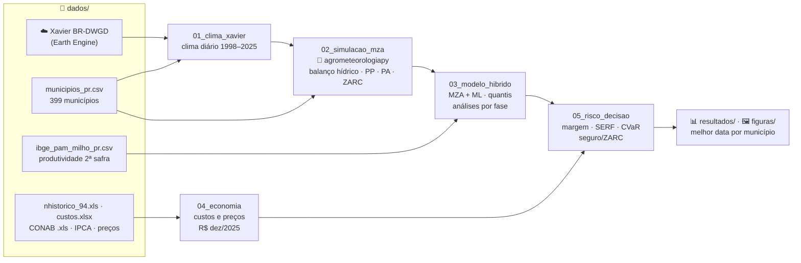

# 🌽 Milho 2ª Safra no Paraná — Modelo Híbrido MZA-FAO + Machine Learning e Risco Econômico da Data de Semeadura


[](https://github.com/fcoliveira-utfpr/agrometeorologiapy)
[](https://pypi.org/project/agrometeorologiapy/)

-0e75b6)


Código e dados do artigo em preparação para o *Journal of Agronomy and Crop Science*. O trabalho
estima a produtividade do **milho 2ª safra nos 399 municípios do Paraná** com um **modelo híbrido**:
o **Modelo da Zona Agroecológica da FAO (MZA-FAO)** calcula o balanço hídrico e as produtividades
potencial e atingível, e o **aprendizado de máquina** corrige o que a física não representa. Sobre
essa produtividade, avalia o **risco econômico de cada data de semeadura** (margem, prejuízo, risco
de cauda, seguro e ZARC) e recomenda a melhor data por município.

O MZA-FAO usa a biblioteca **[agrometeorologiapy](https://pypi.org/project/agrometeorologiapy/)**
(`pip install agrometeorologiapy`), do mesmo autor.

UTFPR – Campus Santa Helena · Prof. Dr. Fabrício Correia de Oliveira

---

## 🗺️ Como os arquivos se conectam



## 📁 Estrutura

```text
.
├── 📓 notebooks/                    pipeline do artigo (executar em ordem)
│   ├── 01_clima_xavier.ipynb        clima diário das sedes municipais (BR-DWGD v3.2.4)
│   ├── 02_simulacao_mza.ipynb       MZA-FAO + critérios ZARC: 399 municípios × 27 anos × 9 datas
│   ├── modelo_mza.py                um ciclo: fenologia por graus-dia, Kc, ky, raiz, ZARC
│   ├── 03_modelo_hibrido.ipynb      (em construção) ML híbrido, validação por ano, análises por fase
│   ├── 04_economia.ipynb            custos (DERAL + Renda de Fatores CONAB) e preços mensais reais
│   └── 05_risco_decisao.ipynb       (em construção) margem, SERF, P(prejuízo), CVaR, seguro/ZARC
├── 📂 dados/                        insumos brutos (fontes abaixo)
├── 📊 resultados/                   saídas dos notebooks (CSV/parquet)
├── 🖼️ figuras/                      figuras do artigo (300 dpi)
└── 🧠 memoria_projeto.md            decisões, bugs corrigidos e próximos passos
```

## 📓 Notebooks

| # | Notebook | Entrada | Saída |
|---|---|---|---|
| 1 | `01_clima_xavier` | Earth Engine, `municipios_pr.csv` | `dados/xavier_diario_pr.csv.gz` (fora do git, 72 MB) |
| 2 | `02_simulacao_mza` | clima diário, `municipios_pr.csv` | `resultados/simulacao_mza_pr.parquet` |
| 3 | `03_modelo_hibrido` | simulação, `ibge_pam_milho_pr.csv` | produtividade prevista (quantis) por município × ano × data |
| 4 | `04_economia` | DERAL, CONAB, Ipeadata, IPCA | `resultados/custos_milho_safrinha_real.csv`, `resultados/precos_milho_pr_mensal_real.csv` |
| 5 | `05_risco_decisao` | notebooks 3 e 4 | risco econômico e melhor data por município |

## 📂 Dados

| Arquivo | Fonte |
|---|---|
| `ibge_pam_milho_pr.csv` | IBGE/PAM, SIDRA tabela 839 — milho 1ª e 2ª safra por município, 2003–2025 |
| `municipios_pr.csv` | Coordenadas da sede, altitude e água disponível no solo (DTA) |
| `nhistorico_94.xls` | SEAB/DERAL — custo de produção do milho safrinha, safras 1999/00–2024/25 |
| `milho_2a_safra_serie_historica_2005-2025.xls` | CONAB — custo do milho 2ª safra (proporção da Renda de Fatores) |
| `custos.xlsx` | SEAB/DERAL — custo detalhado por item (2025–2026) |
| `ipea_precos_milho_mensal.csv` | Preço recebido pelo produtor no PR (SEAB/DERAL via Ipeadata) |
| `ipca_mensal.csv` | IPCA mensal (BCB/SGS 433) |

Clima: Xavier, A. C.; Scanlon, B. R.; King, C. W.; Alves, A. I. New improved Brazilian daily weather
gridded data (1961–2020). *International Journal of Climatology*, 42(16), 8390–8404, 2022.

## ⚙️ Como executar

```bash
python3.13 -m venv .venv313
.venv313/bin/pip install agrometeorologiapy==0.3.0 pandas numpy scipy matplotlib scikit-learn \
    shap mapie earthengine-api pyarrow xlrd openpyxl nbconvert ipykernel
.venv313/bin/python -m ipykernel install --user --name milho_pr

cd notebooks
../.venv313/bin/python -m nbconvert --to notebook --execute --inplace \
    --ExecutePreprocessor.kernel_name=milho_pr 01_clima_xavier.ipynb   # e assim por diante
```

O notebook 01 exige uma conta do Google Earth Engine com projeto Cloud registrado.
