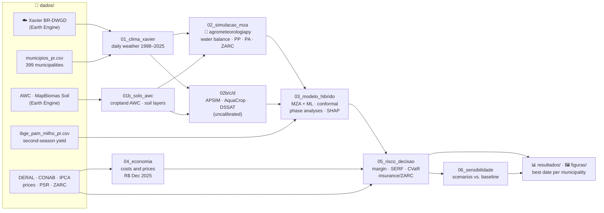

# 🌽 Second-Season Maize in Paraná — Hybrid MZA-FAO + Machine Learning Model and Economic Risk of the Sowing Date


[](https://github.com/fcoliveira-utfpr/agrometeorologiapy)
[](https://pypi.org/project/agrometeorologiapy/)

-0e75b6)


Code and data of an article in preparation for the *Journal of Agronomy and Crop Science*. The study
predicts the yield of **second-season (safrinha) maize in the 399 municipalities of Paraná, Brazil**,
with a **hybrid model**: the **FAO Agro-Ecological Zone model (MZA-FAO)** computes the crop water balance
and the potential and attainable yields, and **machine learning** corrects what the physics does not
represent. On top of that yield distribution, it evaluates the **economic risk of each sowing date**
(margin, probability of loss, tail risk, crop insurance and the official agricultural climate risk
zoning, ZARC) and recommends the best sowing date for each municipality.

MZA-FAO runs on the **[agrometeorologiapy](https://pypi.org/project/agrometeorologiapy/)** library
(`pip install agrometeorologiapy`), by the same author.

UTFPR – Santa Helena Campus · Prof. Dr. Fabrício Correia de Oliveira

---

## 🔎 Main results

- **Final model** — ensemble of a physics-guided gradient boosting (monotonic constraints) and a support
  vector regression, both on MZA-FAO features. Leave-one-year-out validation (23 folds, 2003–2025,
  6,806 municipality-years): R² = 0.43 (municipality), 0.54 (microregion), 0.61 (mesoregion) and 0.67
  (state, between years); 79% coverage of the 80% conformal interval.
- **Feature generators** — uncalibrated APSIM NG, DSSAT CERES-Maize and AquaCrop do not beat the simple
  MZA-FAO; with an identical automatic feature selection, MZA, APSIM and DSSAT perform alike and AquaCrop
  is worse. The gain comes from agronomically designed features, physical constraints and the ensemble.
- **Decision** — the earliest date (5 January) maximizes the certainty equivalent in most municipalities;
  the western border and the sandy northwest prefer mid-March, because early sowing flowers under heat
  (Tmax ≥ 35 °C), a stress the ML adds to the MZA-FAO. ZARC-linked insurance is worth R$ 39–75 ha⁻¹ (mean by sowing date).
  The modelled field-level failure frequency follows the indemnified policies of the federal insurance
  subsidy programme (PSR) between years (r = 0.88).
- **Sensitivity** — thermal time ± 100 °C d, sowing-window weights, total vs. operating cost, insurance
  coverage, ZARC cycle group and days to sale keep the same best date in 78–99% of the municipalities.

## 🗺️ How the files connect



## 📁 Structure

```text
.
├── 📓 notebooks/                      article pipeline (run in order)
│   ├── 01_clima_xavier.ipynb          daily weather at the municipal seats (BR-DWGD v3.2.4)
│   ├── 01b_solo_awc.ipynb             AWC over the cropland of each municipality; soil layers (MapBiomas Soil)
│   ├── 02_simulacao_mza.ipynb         MZA-FAO + ZARC criteria: 399 municipalities × 27 years × 9 dates
│   ├── 02b_simulacao_apsim.ipynb      APSIM NG Maize, uncalibrated
│   ├── 02c_simulacao_aquacrop.ipynb   AquaCrop-OSPy, uncalibrated
│   ├── 02d_simulacao_dssat.ipynb      DSSAT CERES-Maize, uncalibrated
│   ├── 03_modelo_hibrido.ipynb        hybrid ML, generator comparison, conformal intervals, phase analyses, SHAP
│   ├── 04_economia.ipynb              costs (DERAL + CONAB Factor Income) and real monthly prices
│   ├── 05_risco_decisao.ipynb         margin, SERF, P(loss), CVaR, insurance/ZARC, best date, Brier score
│   ├── 06_sensibilidade.ipynb         sensitivity scenarios compared with the baseline
│   ├── modelo_mza.py                  one MZA-FAO cycle: degree-day phenology, Kc, ky, roots, ZARC
│   ├── modelo_apsim.py · modelo_aquacrop.py · modelo_dssat.py   process-model drivers
│   ├── rodar_lote.py                  parallel runs with a checkpoint per municipality
│   ├── sensibilidade.py               scenario definitions (environment variable SENS)
│   └── mapas.py                       choropleth maps without geopandas
├── 📂 dados/                          raw inputs (sources below)
├── 📊 resultados/                     notebook outputs (CSV/parquet); sensibilidade/<scenario>/
├── 🖼️ figuras/                        article figures (300 dpi)
└── 🧠 memoria_projeto.md              decisions, fixed bugs and next steps (in Portuguese)
```

## 📓 Notebooks

| # | Notebook | Input | Output |
|---|---|---|---|
| 1 | `01_clima_xavier` | Earth Engine, `municipios_pr.csv` | `dados/xavier_diario_pr.csv.gz` (not in git, 72 MB) |
| 1b | `01b_solo_awc` | Earth Engine (AWC, MapBiomas), municipal mesh | `municipios_pr.csv` (DTA), `solo_camadas_pr.csv` |
| 2 | `02_simulacao_mza` | daily weather, municipalities | `resultados/simulacao_mza_pr.parquet` |
| 2b–d | `02b/c/d_simulacao_*` | daily weather, soil layers | `resultados/simulacao_{apsim,aquacrop,dssat}_pr.parquet` |
| 3 | `03_modelo_hibrido` | simulations, `ibge_pam_milho_pr.csv` | validation tables, out-of-sample predictions, yield quantiles per municipality × year × date |
| 4 | `04_economia` | DERAL, CONAB, Ipeadata, IPCA | `resultados/custos_milho_safrinha_real.csv`, `resultados/precos_milho_pr_mensal_real.csv` |
| 5 | `05_risco_decisao` | notebooks 3 and 4, ZARC, PSR | economic risk and best date per municipality |
| 6 | `06_sensibilidade` | `resultados/sensibilidade/*` | `resultados/sensibilidade_cenarios.csv` |

## 📂 Data

| File | Source |
|---|---|
| `ibge_pam_milho_pr.csv` | IBGE/PAM, SIDRA table 839 — first- and second-season maize per municipality, 2003–2025 |
| `municipios_pr.csv` | Seat coordinates, altitude, soil available water (DTA) and particle size |
| `malha_municipios_pr.geojson` | IBGE municipal boundaries |
| `solo_camadas_pr.csv` | MapBiomas Soil Collection 3 — clay and sand in 10 layers (0–100 cm) |
| `nhistorico_94.xls` | SEAB/DERAL — second-season maize production cost, seasons 1999/00–2024/25 |
| `milho_2a_safra_serie_historica_2005-2025.xls` | CONAB — second-season maize cost (Factor Income share) |
| `custos.xlsx` | SEAB/DERAL — itemized cost (2025–2026) |
| `ipea_precos_milho_mensal.csv` | Price received by farmers in Paraná (SEAB/DERAL via Ipeadata) |
| `ipca_mensal.csv` | Monthly IPCA consumer price index (BCB/SGS 433) |
| `zarc_milho2safra_pr_2026_2027.csv` | MAPA — official ZARC risk table, second-season maize, Paraná, 2026/2027 |
| `psr_milho2safra_pr_*.csv` | MAPA/SISSER — subsidized crop insurance policies (PSR), second-season maize, Paraná |

Weather: Xavier, A. C.; Scanlon, B. R.; King, C. W.; Alves, A. I. New improved Brazilian daily weather
gridded data (1961–2020). *International Journal of Climatology*, 42(16), 8390–8404, 2022.

## ⚙️ How to run

```bash
python3.13 -m venv .venv313
.venv313/bin/pip install -r requirements.txt
.venv313/bin/python -m ipykernel install --user --name milho_pr

cd notebooks
../.venv313/bin/jupyter nbconvert --to notebook --execute --inplace \
    --ExecutePreprocessor.kernel_name=milho_pr 02_simulacao_mza.ipynb   # and so on, in order

# sensitivity scenarios (CT1350, CT1550, janela_cedo, janela_7datas): rerun 02 → 03 → 05 with
SENS=CT1550 ../.venv313/bin/jupyter nbconvert --to notebook --execute 02_simulacao_mza.ipynb \
    --output-dir ../resultados/sensibilidade/CT1550
```

- Notebooks 01 and 01b require a Google Earth Engine account with a registered Cloud project.
- 02b needs APSIM Next Generation built from source (`APSIMInitiative/ApsimX`, .NET 8); 02d needs
  DSSAT-CSM built from source (`DSSAT/dssat-csm-os`, gfortran + cmake) on macOS. Their consolidated
  outputs are in `resultados/`, so notebooks 03–06 run without them.
- On macOS, XGBoost/LightGBM (used only in the algorithm comparison) need `brew install libomp`.
